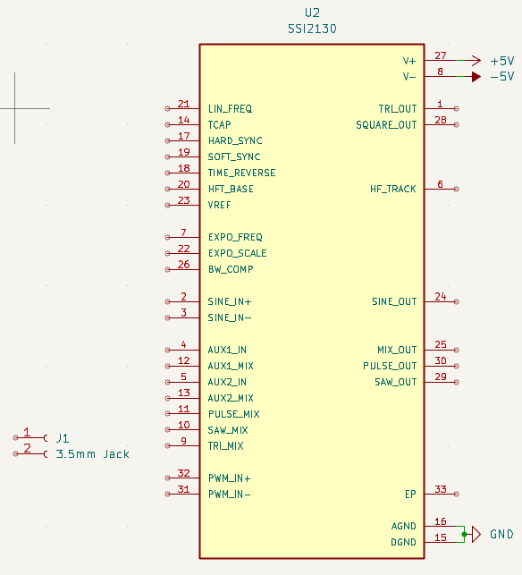
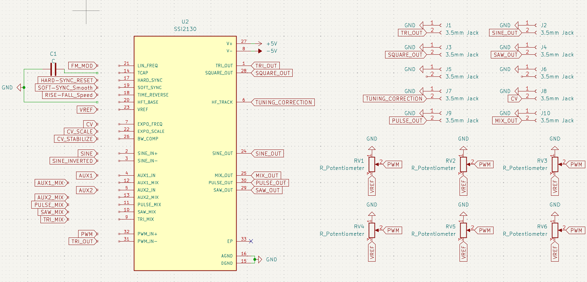
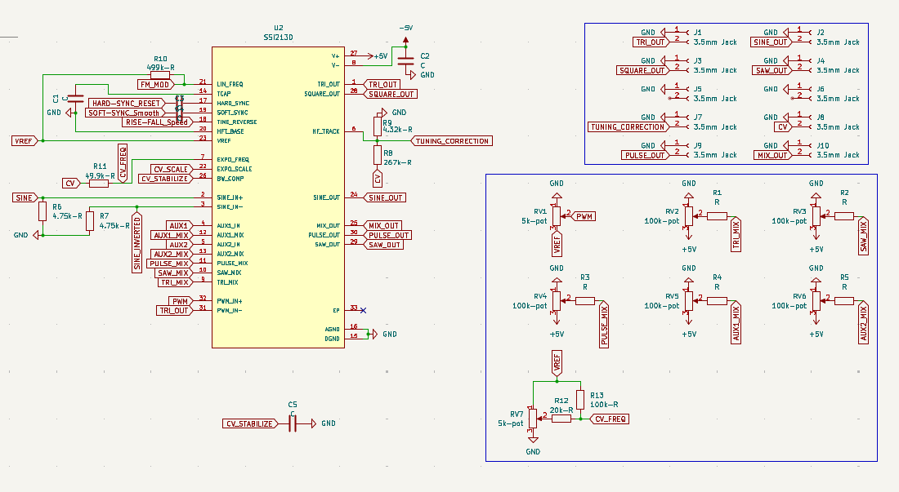
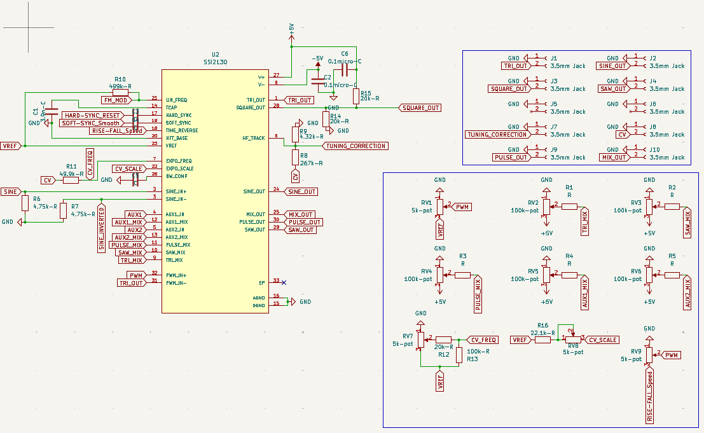
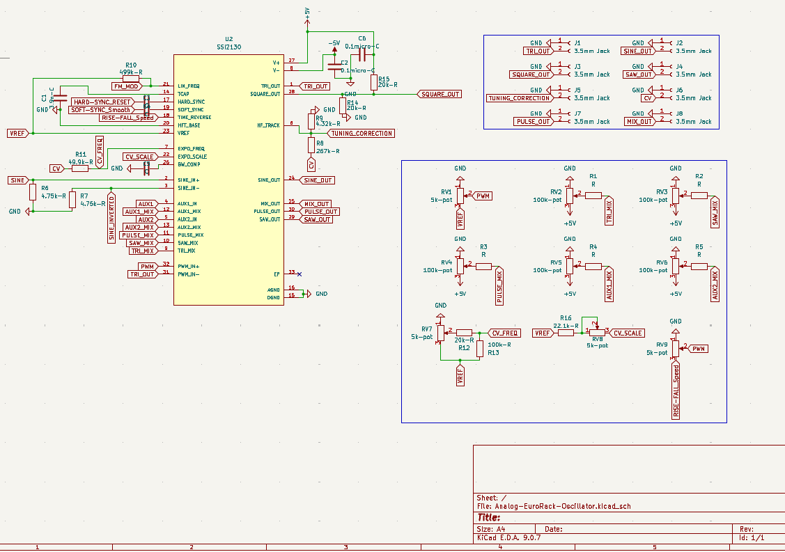
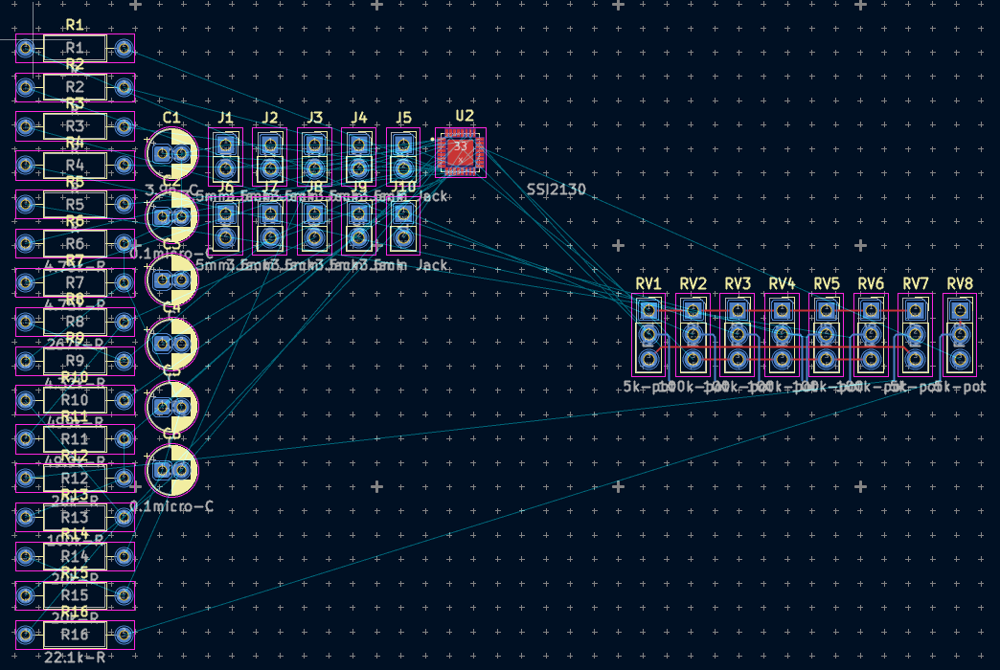
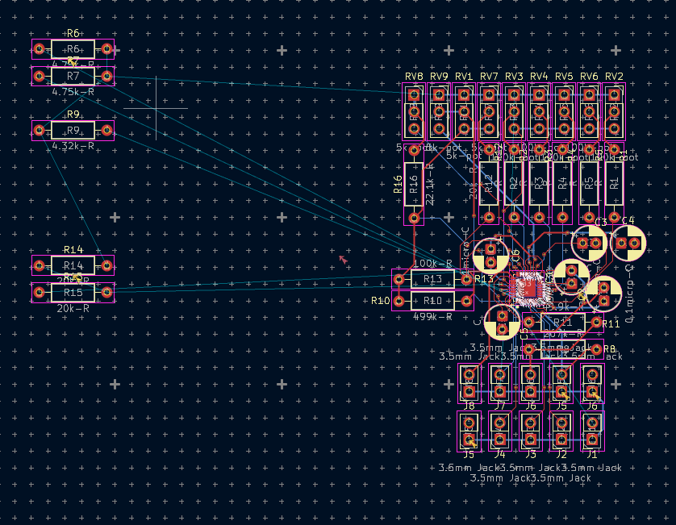
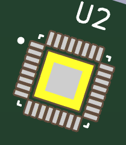
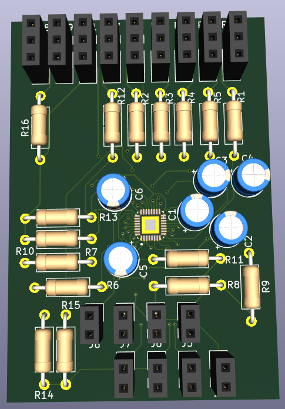
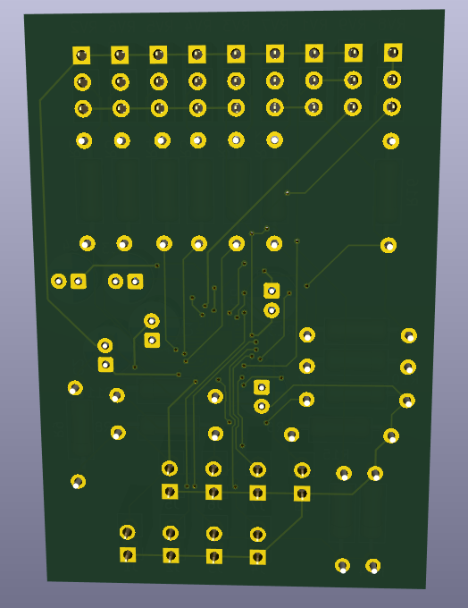

# Analog-EuroRack
### - Description
This is an analog eurorack where you can direct signals from one module to the next and by that, produce sound.
This ia a project I have been working on for a Music project for a thing called [Half Life](https://halflife.hackclub.com).
I wanted to do something interresting, a way that you could create your own unique sound rather than writing it with code.

### - What is the meaning
The meaning for this project is that you can redirect signals from different connections and in the end get your own uniquely modulated sound. Because I have tried to have it as a "EuroRack Format" it means that in the future if I keep working on this project, I could add more modulators such as low and high pass filters, reverb, distortion, and plenty more.

### - What does this project do
This project's purpose is to allow the user to create their own sound by own taste.

### - Problems along the way
With this project it is mostly one combine problem that I have had. When trying to wire the cables and components on my PCB I struggled to fit everything in a compact area. This lead to me having cables delivering differnt signals across each other on 2 different layers and it beeing so tight that, wanting to move a single cable could include you having to move a few more components to make room in a safe way.

---

### - Schematic
The schematic might look a bit messed and stuff beeing all over but I tried to make it simple to follow. To the left I have the main component, a **SSI2130** and it's purpose is simply taking all of the different parameters and values, combining them and produce custom sounds out.

### - PCB
The PCB in other hand might be a bit more complex trying to understand.
The main part is that the SSI2130 sits in the middle and acting as the main component. To it there are capacitors, resistors, audio jacks and potentiometers connected, allowing the user to customize the sound to their own likings. Some potentiometers control the pitch of the outcoming sound and connecting to one of the 4 upper right audio jacks on the schematic gives you different sound waves such as Triangle, Sine, Square and Saw.

---
### - Build Of Materials
| Item                     | Qty | Supplier   | Cost/item | Total Cost | link                                    |
|--------------------------|-----|------------|-----------|------------|-----------------------------------------|
|                          |     |            |           |            |                                         |
| TOTAL                    |     |            |           | $0         |                                         |
